# Identity-Centric Security Architecture for Industrial AI and Autonomous Robotics

**Integrating Non-Human Identity, Industrial Zero Trust, Cloud and OT Security for Intelligent Logistics**

*An architecture for secure Robotics-as-a-Service (RaaS), autonomous warehouses, and intelligent distribution systems.*


## Table of contents

- [Project overview](#1-project-overview)
- [Architecture goals and scope](#2-architecture-goals-and-scope)
- [System architecture](#3-system-architecture)
- [Purdue model and industrial deployment](#4-purdue-model-and-industrial-deployment)
- [Trust boundaries and authorized conduits](#5-trust-boundaries-and-authorized-conduits)
- [Identity and Trust Fabric](#6-identity-and-trust-fabric)
- [Identity and authorization flows](#7-identity-and-authorization-flows)
- [Authorization model](#8-authorization-model)
- [Industrial AI and robotic security](#9-industrial-ai-and-robotic-security)
- [RaaS, intelligent logistics, and tenant isolation](#10-raas-intelligent-logistics-and-tenant-isolation)
- [OT monitoring and incident response](#11-ot-monitoring-and-incident-response)
- [Technology stack](#12-technology-stack)
- [Reference configuration and implementation](#13-reference-configuration-and-implementation)
- [Threat model](#14-threat-model)
- [Resilience and failure behavior](#15-resilience-and-failure-behavior)
- [Architectural decisions and principles](#16-architectural-decisions-and-principles)
- [Standards and frameworks](#17-standards-and-frameworks)
- [Repository structure](#18-proposed-repository-structure)
- [Implementation roadmap](#19-implementation-roadmap)
- [Experimental validation](#20-experimental-validation)
- [Research contribution](#21-research-contribution)
- [References](#22-references)

## 1. Project overview

This project proposes a distributed cyber-physical platform that combines Industrial AI, autonomous mobile robots (AMRs), Industrial IoT (IIoT), Operational Technology (OT), cloud-native services, and intelligent logistics to support small and medium-sized businesses (SMBs).

YOLOv12-based computer vision and local Edge AI enable product detection, classification, inventory reconciliation, and warehouse visibility. ROS 2-based robotics and local fleet management coordinate inspection and material handling. Enterprise integration connects operational information to warehouse management, demand forecasting, automated transport, and international distribution.

The primary research contribution is not object detection itself. It is an **Industrial Identity and Trust Fabric** that brings identity-centric security to autonomous industrial systems: robots, IoT devices, workloads, AI services, autonomous agents, APIs, and external service providers.

The platform applies Industrial Zero Trust, risk-based IEC 62443 zones and conduits, Purdue-inspired network segmentation, and NIST OT security guidance to the convergence of Cloud, IT, Edge, and OT.

### Core research pillars

| Pillar | Scope |
| --- | --- |
| Industrial Non-Human Identity (NHI) | Machine identities, workload attestation, PKI, short-lived credentials, identity lifecycle and federation |
| Industrial Zero Trust | Explicit authentication, context-aware authorization, least privilege, distributed enforcement |
| Industrial AI Security | Model provenance, signed artifacts, secure deployment, inference integrity, bounded AI autonomy |
| Secure Cloud-to-OT integration | Industrial DMZ, authenticated conduits, local policy decisions, monitored enterprise integration |
| Secure Robotics-as-a-Service | Tenant isolation, fleet governance, customer-approved remote maintenance and service monitoring |
| Cyber-physical resilience | Local safety, anomaly correlation, controlled containment, offline operation and recovery |
| Intelligent logistics | Inventory intelligence, demand forecasting, WMS/ERP integration, transport and international distribution |

## 2. Architecture goals and scope

- Establish unique, verifiable identities for humans, robots, devices, services, and AI workloads.
- Authorize interactions according to subject, resource, action, ownership, and verified operational context.
- Prevent direct cloud access to low-level robotic control or safety interfaces.
- Secure industrial communication, software and firmware updates, and AI model deployment.
- Support customer-controlled, time-limited remote maintenance and revocation.
- Isolate customer data, credentials, robot fleets, and administrative privileges.
- Maintain safe local operation under defined connectivity and security-service failures.
- Evaluate security, operational performance, scalability, and cost-effectiveness in an isolated research testbed.

**Non-goals:** building a full commercial ERP/WMS, replacing certified safety controls, treating YOLOv12 as a security detector, requiring SPIFFE on legacy PLCs, or claiming regulatory certification from architectural alignment alone.

## 3. System architecture

### 3.1 Logical domains

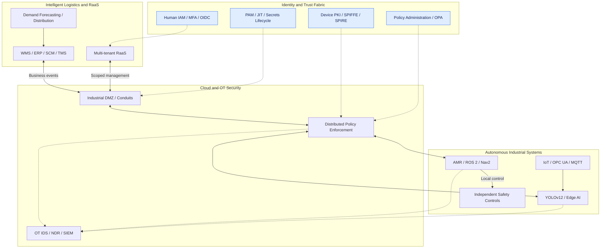

The trust fabric is a **cross-cutting service plane**, not an inline network hop for every communication. Authentication, authorization, and physical safety are distinct responsibilities.

### 3.2 Architecture planes

| Plane | Responsibility |
| --- | --- |
| Identity | Enrollment, attestation, credential issuance and lifecycle |
| Trust and policy | Policy administration, verified context and authorization decisions |
| Management | Fleet provisioning, maintenance, service configuration and releases |
| Data | Inventory events, inference results, telemetry and enterprise synchronization |
| Control | Local mission execution, navigation and automation |
| Safety | Independent protective functions, interlocks and emergency stops |
| Observability | Audit, monitoring, security correlation and incident response |

### 3.3 Detailed component diagram

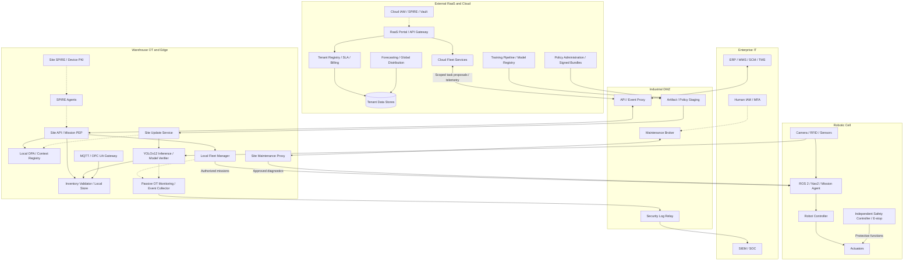

All cross-zone arrows denote logical, explicitly authorized conduits, not unrestricted routing. Cloud-originated requests are delivered using controlled application exchanges, preferably over site-initiated connections. The physical safety interface is independently engineered; the diagram does not prescribe a safety circuit.

### 3.4 Main operational components

| Component | Responsibility |
| --- | --- |
| AMR and mission agent | Execute assigned inspection and transport tasks |
| Local fleet manager | Allocate missions, enforce operational constraints, track robot state |
| Edge perception service | Run YOLOv12, track observations, publish validated detection events |
| Inventory validator | Reconcile detections with product identifiers, location and authoritative WMS records |
| IIoT gateway | Terminate device connections and translate approved industrial protocols |
| Asset/context registry | Map authenticated identities to tenant, site, asset, lifecycle and posture |
| Site PEP and PDP | Enforce and evaluate resource-level access policy |
| Site identity authority | Issue and renew locally trusted workload identities |
| Industrial DMZ | Mediate application exchange, maintenance, artifact staging and log forwarding |
| RaaS control plane | Manage service lifecycle, tenants, fleet visibility and service levels |
| AI registry and release pipeline | Track provenance, validation, versioning and signed deployment artifacts |
| Security operations | Correlate security and operational events, coordinate approved response |
| Independent safety system | Enforce safety functions regardless of cloud, AI or identity service availability |

## 4. Purdue model and industrial deployment

The seven functional layers of the project are mapped to a Purdue-inspired industrial topology. Functional layers are not identical to network security zones; cloud and Level 3.5 are practical extensions used in this design.

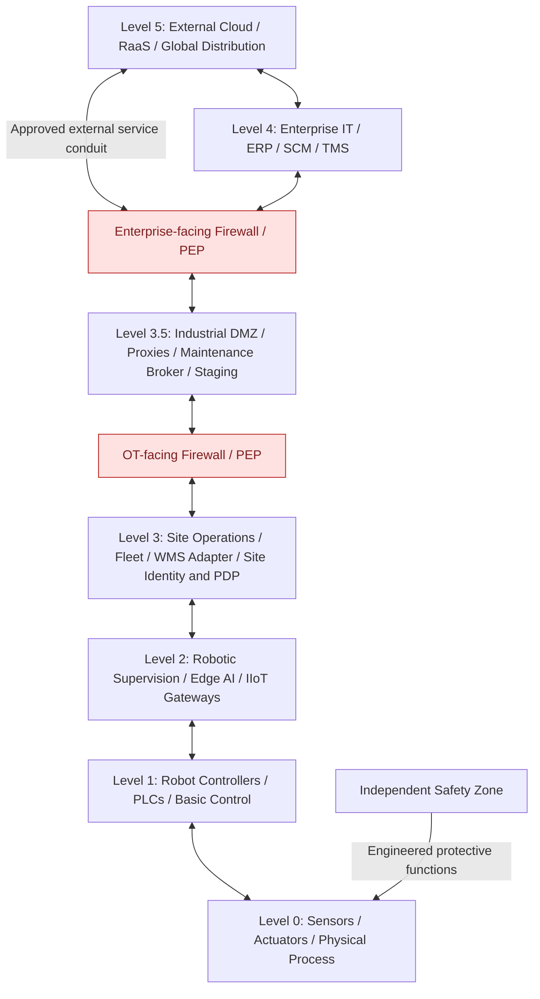

| Level | Proposed deployment |
| --- | --- |
| 0 | Physical assets, cameras, sensors, actuators |
| 1 | Robot controllers, PLCs and local basic control |
| 2 | Supervisory robotics, ROS 2, Edge AI, IIoT gateways |
| 3 | Site operations, local fleet, inventory, local policy and identity services |
| 3.5 | Industrial DMZ: API, event, maintenance, artifact and log proxies |
| 4 | Enterprise IT, WMS/ERP, business identity, SOC |
| 5 | RaaS, external cloud, model training and international distribution |

### 4.1 Proposed laboratory deployment

One AMR with RGB camera, LiDAR and proximity sensors; one Jetson-class inference device; one local OT server; an industrial gateway; managed switching and firewall segmentation; a WMS/ERP simulator; a PLC simulator or isolated controller; and a cloud RaaS environment. Multiple customers can be simulated without requiring multiple physical robots.

| Zone | Example VLAN | Example subnet |
| --- | ---: | --- |
| Enterprise IT | 10 | `10.30.10.0/24` |
| Industrial IoT | 20 | `10.30.20.0/24` |
| Edge AI | 30 | `10.30.30.0/24` |
| Robotic operations | 40 | `10.30.40.0/24` |
| OT security | 50 | `10.30.50.0/24` |
| Industrial DMZ | 60 | `10.30.60.0/24` |
| Infrastructure management | 70 | `10.30.70.0/24` |

VLANs alone are not sufficient security boundaries: inter-zone traffic requires enforced routing/firewall policies. Safety communication is separately engineered, not assigned to a general-purpose routable VLAN by default.

## 5. Trust boundaries and authorized conduits

### 5.1 Trust boundary diagram

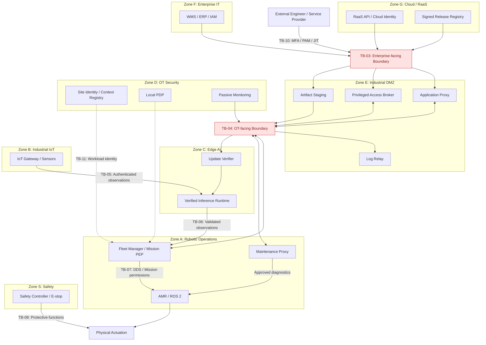

### 5.2 Trust boundary register

| ID | Boundary | Principal risk | Primary control |
| --- | --- | --- | --- |
| TB-01 | Internet to RaaS | Unauthorized access | API gateway, OIDC, MFA, rate limits |
| TB-02 | Tenant to tenant | Cross-customer access | Tenant-scoped identity, policies, storage and keys |
| TB-03 | Enterprise/external services to DMZ | Lateral movement | Firewall, protocol termination, application proxy |
| TB-04 | DMZ to OT | Industrial network compromise | Independent OT firewall, explicit conduits, site PEP |
| TB-05 | IoT to Edge AI | Sensor spoofing and manipulation | Device PKI, ACLs, provenance, plausibility checks |
| TB-06 | Edge AI to robotics | Unsafe or unauthorized decision proposals | Typed interfaces, validation, local authorization |
| TB-07 | Fleet to robot | Unauthorized mission/control access | DDS Security, mission PEP, per-robot privileges |
| TB-08 | Robot control to safety/physical process | Unsafe physical action | Independently validated safety controls |
| TB-09 | Build/release pipeline to runtime | Malicious model or software | Signed manifests, provenance, version policy |
| TB-10 | Vendor to maintenance service | Privileged access abuse | Customer approval, MFA, PAM, JIT, recording |
| TB-11 | Identity authority to workload | Impersonation or credential theft | Attestation, isolated keys, short-lived credentials |

TB-01 and TB-02 are detailed in the RaaS section; TB-09 is detailed in the AI supply-chain diagram. Each boundary is a candidate for formal zone/conduit risk assessment, not a predetermined IEC 62443 security level.

### 5.3 Authorized conduits

| Source | Destination | Protocol / mechanism | Scope |
| --- | --- | --- | --- |
| Robot mission agent | Local mission API | HTTPS/gRPC with mTLS | Own task requests and status |
| Authorized ROS 2 nodes | Approved DDS participants | DDS Security | Explicit topic, service and action permissions |
| IoT device | Site MQTT broker | MQTTS / TCP 8883 | Device-specific telemetry topics |
| OPC UA gateway | Approved industrial endpoint | SignAndEncrypt | Approved reads or explicitly scoped operations |
| Edge inference service | Inventory validator | HTTPS/gRPC with mTLS | Detection events only |
| Site integration service | DMZ application proxy | HTTPS with mTLS | Inventory/events and approved task proposals |
| DMZ proxy | RaaS/enterprise API | HTTPS with mTLS | Scoped application exchange |
| Maintenance broker | Site maintenance proxy | Restricted encrypted session | Approved asset, operation and time window |
| Site update service | DMZ artifact staging | HTTPS with mTLS | Approved signed releases |
| Site log collector | DMZ relay | TLS-protected log transport | Security events |
| DMZ log relay | Enterprise SIEM | TLS-protected log transport | Forwarded events |
| SPIRE agents | Site SPIRE authority | Authenticated SPIRE channel | Attestation and identity renewal |

All other inter-zone flows are denied by default. Exact endpoints, direction of connection initiation, ports, service identities and exception handling must be recorded in the deployment-specific conduit inventory. A gateway must not create an unrestricted reverse tunnel.

## 6. Identity and Trust Fabric

### 6.1 Identity taxonomy

| Identity | Example | Mechanism |
| --- | --- | --- |
| Human operator | Warehouse operator | OIDC, MFA as required |
| Privileged human | RaaS engineer | MFA, PAM, JIT approval |
| Machine | AMR-001 | Unique X.509 device certificate, hardware-backed key where supported |
| IoT device | Camera-001 | Device PKI or isolated gateway mediation |
| Workload | Inventory service | SPIFFE X.509-SVID |
| AI workload | YOLOv12 service | Dedicated SPIFFE X.509-SVID |
| Autonomous agent | Logistics agent | Dedicated workload identity and tool-level policy |
| CI/CD workload | Release pipeline | Federated workload identity and controlled signing permissions |
| Artifact | Model/firmware version | Signed manifest, digest, provenance (not a workload credential) |

Device enrollment and workload attestation are separate processes. A legitimate device does not automatically authorize every process running on it. Legacy devices that cannot authenticate natively require segmentation and compensating controls; a gateway identity does not prove the identity of an unauthenticated device behind it.

### 6.2 Workload trust domains

Example domains (illustrative, not deployed DNS names):

```text
raas.example.org
acme.wh01.ot.example.org
acme.wh02.ot.example.org
globex.wh01.ot.example.org
```

Example identities:

```text
spiffe://acme.wh01.ot.example.org/robot/amr-001/mission-agent
spiffe://acme.wh01.ot.example.org/service/fleet-manager
spiffe://acme.wh01.ot.example.org/service/inventory
spiffe://acme.wh01.ot.example.org/ai/yolov12
spiffe://raas.example.org/service/fleet-api
```

Site-local SPIRE authorities issue short-lived workload identities. Explicit federation is limited to selected integration workloads. Federation permits verification of a remote trust domain; resource authorization remains a separate decision. Trust anchors, federation configuration, issuer keys, registration and rotation are privileged administrative assets.

### 6.3 Identity lifecycle

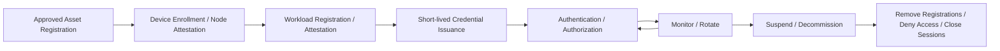

Device status and workload ownership are maintained in the asset registry. On compromise or decommissioning, disable access, remove registrations, invalidate or revoke applicable device credentials, and terminate supported active sessions. Short-lived SVIDs reduce exposure but do not automatically terminate established connections.

## 7. Identity and authorization flows

### 7.1 Robot onboarding and workload attestation

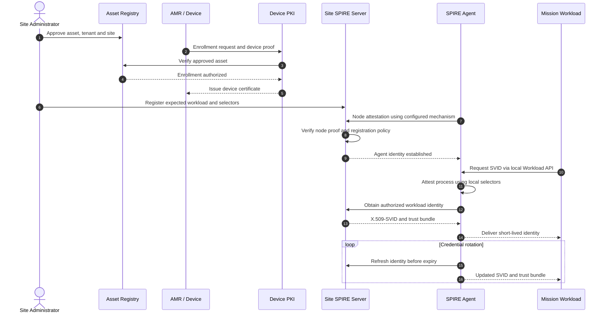

### 7.2 Robot-to-service authentication and authorization

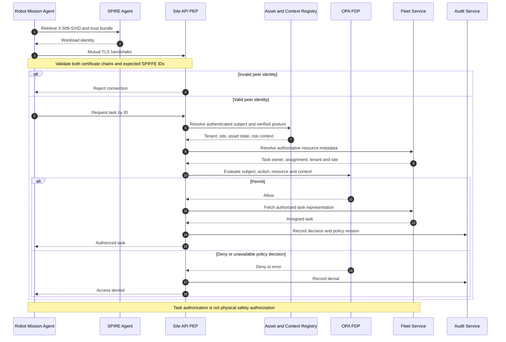

### 7.3 Secure remote maintenance

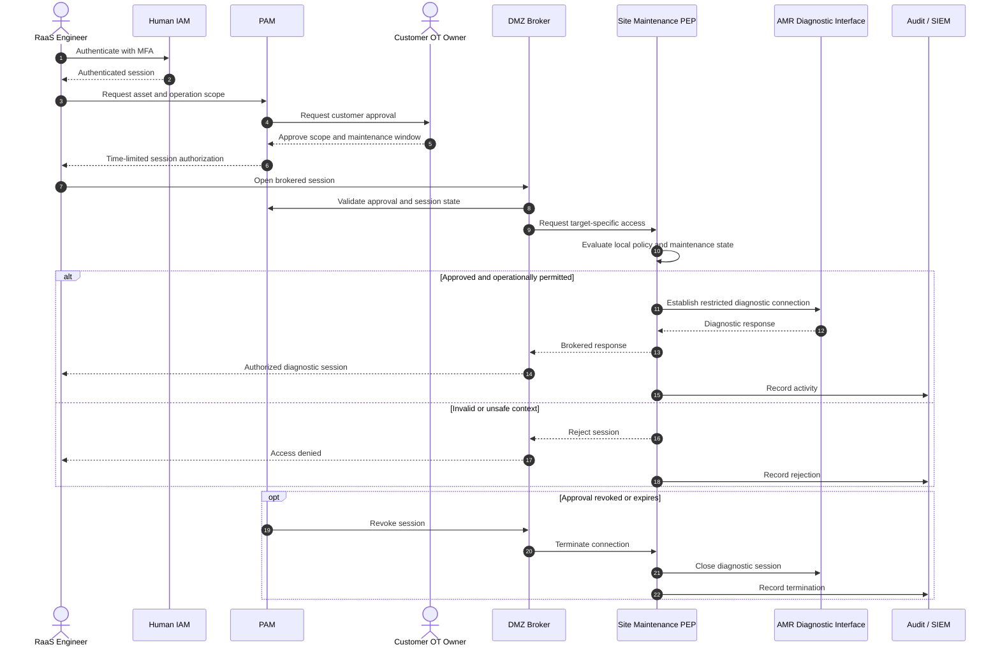

No permanent vendor access, direct OT routing, shared administrative account, or arbitrary cloud-issued actuator command is required. Maintenance connectivity can use a site-initiated, target-restricted channel. Session expiry is enforced locally as well as by the broker; loss of connectivity must not extend access indefinitely. Sensitive changes require a separate approved change process.

## 8. Authorization model

Combine role-based access control (RBAC), attribute-based access control (ABAC), and explicit resource ownership/assignment relationships (ReBAC-style checks).

| Element | Responsibility |
| --- | --- |
| PAP | Version, review, approve, sign and distribute policy |
| PDP | Evaluate verified subject, action, resource and context (local OPA) |
| PEP | Enforce decisions at APIs, robot gateways, industrial proxies and PAM |
| PIP | Supply verified asset, posture, assignment, tenant and risk context |
| Identity provider | Establish authenticated human/device/workload identity |

### Permission matrix

| Subject | Inventory read | Detection publish | Task access | Mission/control | Maintenance | Model deployment |
| --- | --- | --- | --- | --- | --- | --- |
| Warehouse operator | Scoped | No | No | No | No | No |
| Robot mission agent | Scoped | No | Own assigned tasks | Execute approved local mission | No | No |
| YOLOv12 workload | No | Scoped | No | No | No | No |
| Fleet manager | Scoped | No | Allocate authorized tasks | Approved missions only | No | No |
| RaaS engineer | No | No | No | No | JIT approved diagnostics | No |
| Deployment pipeline | No | No | No | No | No | Approved releases |
| Logistics AI agent | Scoped | No | Propose tasks | No actuator access | No | No |

Authorization decisions must be based on trusted identity and authoritative resource metadata, not client-provided tenant or posture assertions. Re-evaluate ongoing access when policy, risk, asset state or session validity changes. Local policy bundles have an explicit freshness limit and trusted signature; stale or unavailable decisions deny new protected actions.

## 9. Industrial AI and robotic security

YOLOv12 performs product detection and classification, not cybersecurity or safety-critical control. Edge inference reduces WAN dependency. Object tracking, barcode/RFID correlation, location mapping, deduplication and reconciliation are required to turn detections into reliable stock records.

### 9.1 Trusted model supply chain

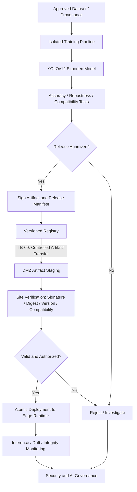

A valid signature does not establish model correctness or safety. Release validation also covers data provenance, expected performance, hardware/runtime compatibility, approved model version, and protection against unauthorized rollback. Maintain a last-known-good compatible release with a controlled rollback procedure.

### 9.2 AI security controls

| Threat | Control |
| --- | --- |
| Dataset poisoning | Dataset lineage, controlled access, validation and approval |
| Model tampering | Signed artifact, digest verification, read-only runtime artifact |
| Unauthorized downgrade | Signed version policy, minimum approved version |
| Adversarial inputs | Input checks, sensor consistency, uncertainty thresholds and reconciliation |
| Model drift | Baseline validation, monitoring and controlled redeployment |
| Model theft | Scoped registry access, encryption and access auditing |
| Inference replay | Authenticated publisher, event IDs, sequence/time checks and deduplication |
| Agent privilege escalation | Per-agent identity, allowed tools/actions and separate execution approval |
| Pipeline compromise | Isolated build environment, scoped workload identity and release approval |

### 9.3 Cyber-physical decision pipeline

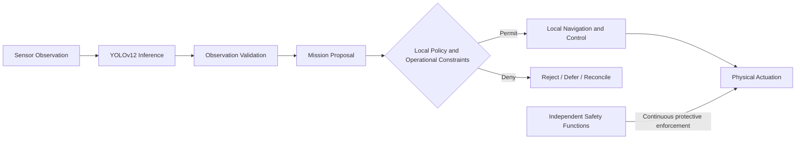

The local fleet/mission service checks resource ownership, approved task type, permitted area, operating state and mission constraints. The safety system remains independently active. AI-generated recommendations must never bypass the authorized mission interface or directly access actuator commands.

### 9.4 Robotic and legacy OT protection

Use ROS 2 with an explicitly supported DDS Security implementation, per-enclave keys and signed governance/permission files. Separate mission, telemetry, navigation and maintenance interfaces. ROS domain IDs and VLANs are not authentication mechanisms. SPIFFE SVIDs and DDS identities are separate credential systems unless an integration has been implemented and validated.

For OPC UA-capable equipment, use authenticated application certificates, trusted endpoint configuration, `SignAndEncrypt` and explicitly authorized methods/nodes. Legacy equipment that cannot support modern authentication should be mediated through controlled gateways, constrained conduits, physical controls and passive monitoring. Avoid indiscriminate active scanning of operational equipment.

## 10. RaaS, intelligent logistics, and tenant isolation

### 10.1 Multi-tenant RaaS

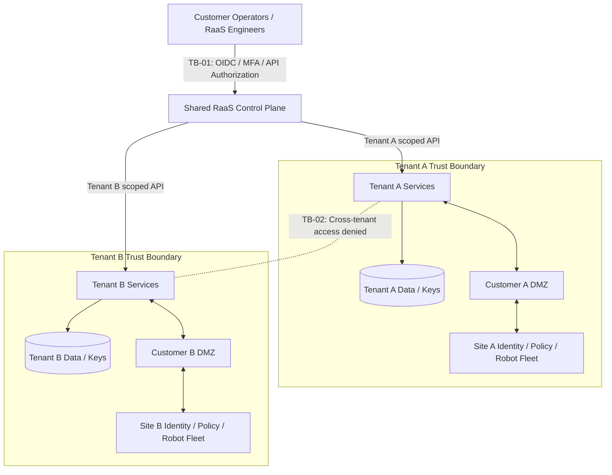

| Isolation layer | Design |
| --- | --- |
| Identity | Customer/site-scoped identities, explicit trust federation |
| Application | Tenant ownership checks on each protected operation |
| Network | Site-level segregation, microsegmentation, restricted external paths |
| Compute | Namespaces, RBAC, admission controls; dedicated clusters when risk requires |
| Data | Row-level security or separate databases, tenant-scoped backups |
| Encryption | Tenant-specific keys where appropriate, scoped key access |
| Robotics | Explicit asset ownership and task assignment |
| Maintenance | Customer-approved, device-specific, time-limited authorization |
| Observability | Tenant-scoped log access and auditable provider access |
| Global distribution | Approved cross-region replication and data residency assessment |

A shared cloud control plane does not automatically imply trusted customer networks. Kubernetes namespaces alone are not a complete tenant security boundary.

### 10.2 Inventory and logistics sequence

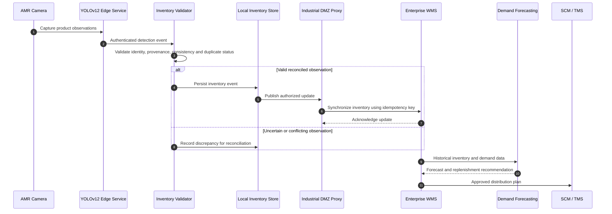

WMS is the proposed authoritative enterprise inventory system. Local records store validated observations and synchronization status. Use persistent event queues, idempotency keys, bounded retry and reconciliation for WAN interruptions. Forecasting and distribution systems generate business recommendations and approved task proposals, not physical control commands.

## 11. OT monitoring and incident response

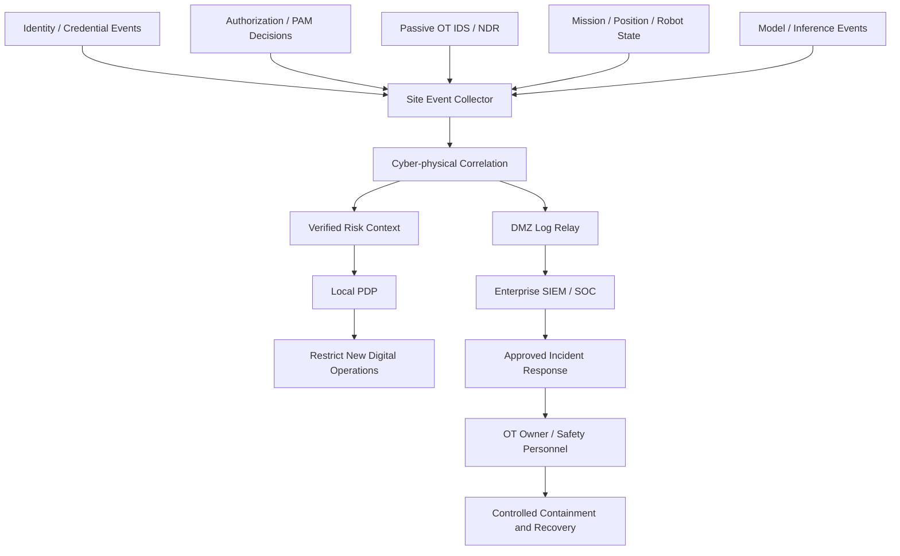

| Detection scenario | Context | Proposed response |
| --- | --- | --- |
| Unexpected robot communication | Device identity, approved conduit, baseline | Alert and evaluate containment |
| Cross-tenant access request | Authenticated identity, resource owner | Deny and audit |
| Unapproved model | Artifact digest, release policy | Reject activation |
| Unusual movement | Mission assignment, position, local sensors | Alert site operator and follow safety procedure |
| Suspicious maintenance | Approved scope, session activity | Terminate access and investigate |
| Inventory discrepancies | Inference results, WMS records | Reconcile and investigate |

Audit events should include a correlation ID, verified subject, tenant/site, resource, action, result, policy version and timestamp. Protect logs against tampering, restrict access, avoid secrets in logs, and buffer local events when the SIEM is unavailable. Retention and privacy requirements are deployment-specific. Security alerts do not directly trigger uncontrolled physical stops.

## 12. Technology stack

| Area | Proposed technology |
| --- | --- |
| Vision and tracking | YOLOv12, OpenCV, suitable object tracking |
| Edge inference | NVIDIA Jetson, TensorRT or supported ONNX runtime |
| Robotics | ROS 2, Nav2, AMR platform |
| Robotic communication | DDS Security / SROS 2 |
| Industrial protocols | OPC UA, MQTT / Mosquitto |
| Human identity | Keycloak, OpenID Connect, MFA |
| Workload identity | SPIFFE/SPIRE |
| Device identity | X.509 PKI, TPM where supported |
| Authorization | Open Policy Agent (OPA), Rego |
| Secrets management | Vault or equivalent |
| Privileged access | PAM solution and restricted maintenance broker |
| Supply chain | Cosign, signed manifests, model registry (e.g. MLflow) |
| OT monitoring | Passive IDS/NDR, asset discovery and protocol-aware monitoring |
| SIEM | Wazuh / Elastic Security or equivalent |
| Cloud | Kubernetes, containers, infrastructure as code |
| Data | PostgreSQL, time-series store, persistent event queue |
| Observability | Grafana, audit/event collection |
| Logistics | WMS/ERP/SCM/TMS adapters, forecasting models |
| Simulation | Optional digital twin or robotics simulator |


## 13. Reference configuration and implementation

### 13.1 SPIRE server and workload identity

Proposed file: `identity/spire/server.conf`

```hcl
server {
    bind_address = "0.0.0.0"
    bind_port = "8081"
    trust_domain = "acme.wh01.ot.example.org"
    data_dir = "/var/lib/spire/server"
    default_x509_svid_ttl = "30m"
}
```

Complete the datastore, key manager, node attestor, CA strategy, agent configuration, protected network binding, backup and recovery settings. Restrict access to the server port at the site firewall. Never expose the agent's Workload API socket to untrusted workloads.

Example registration (run by an authorized SPIRE administrator):

```bash
spire-server entry create \
  -spiffeID spiffe://acme.wh01.ot.example.org/robot/amr-001/mission-agent \
  -parentID "$ATTESTED_AGENT_ID" \
  -selector unix:user:robot-mission \
  -x509SVIDTTL 1800
```

### 13.2 OPA policy as code

File: `authorization/policies/robot_tasks.rego`

```rego
package industrial.authz

import rego.v1

default allow := false

allow if {
    input.subject.authenticated == true
    input.subject.type == "robot_workload"
    input.action == "task:read"
    input.resource.type == "robot_task"
    input.subject.tenant_id == input.resource.tenant_id
    input.subject.site_id == input.resource.site_id
    input.subject.spiffe_id == input.resource.assigned_to
    input.context.device_status == "active"
    input.context.device_posture == "compliant"
    input.context.policy_fresh == true
    input.context.risk_level == "low"
}
```

Example PEP-generated input: `authorization/examples/robot-task.json`

```json
{
  "subject": {
    "authenticated": true,
    "type": "robot_workload",
    "spiffe_id": "spiffe://acme.wh01.ot.example.org/robot/amr-001/mission-agent",
    "tenant_id": "acme",
    "site_id": "wh01"
  },
  "action": "task:read",
  "resource": {
    "type": "robot_task",
    "id": "task-1042",
    "tenant_id": "acme",
    "site_id": "wh01",
    "assigned_to": "spiffe://acme.wh01.ot.example.org/robot/amr-001/mission-agent"
  },
  "context": {
    "device_status": "active",
    "device_posture": "compliant",
    "policy_fresh": true,
    "risk_level": "low"
  }
}
```

Example evaluation once the files exist and a compatible OPA version is installed:

```bash
opa eval \
  --data authorization/policies/robot_tasks.rego \
  --input authorization/examples/robot-task.json \
  'data.industrial.authz.allow'
```

Expected result for the example input: `true`. Changing the tenant, site, task assignment, identity status, verified posture, policy freshness or risk level to a disallowed value must deny access. This is an expected result, not an executed test.

### 13.3 Policy Enforcement Point (Python pseudocode)

Proposed file: `authorization/enforcement/task_gateway.py`

```python
def get_robot_task(request, task_id):
    # Derived from a validated mTLS channel, never a user-supplied header.
    peer = verified_tls_peer(request)
    if peer is None:
        return response(status=401)

    subject = asset_registry.resolve_workload(peer.spiffe_id)
    if subject is None:
        return response(status=403)

    # Use authoritative, tenant/site-scoped lookup and uniform error handling.
    task = task_repository.find_scoped(
        task_id, tenant_id=subject.tenant_id, site_id=subject.site_id
    )
    if task is None:
        audit.record_denial(peer.spiffe_id, task_id)
        return response(status=403)

    try:
        context = posture_service.get_verified_context(subject.asset_id)
        policy_input = {
            "subject": subject.authorization_attributes(),
            "action": "task:read",
            "resource": task.authorization_attributes(),
            "context": context,
        }
        allowed = opa.evaluate(
            "industrial/authz/allow", policy_input
        ) is True
    except (PolicyServiceUnavailable, ContextUnavailable):
        allowed = False

    audit.record(
        subject=peer.spiffe_id,
        resource=task_id,
        action="task:read",
        decision="allow" if allowed else "deny",
    )
    if not allowed:
        return response(status=403)

    return response(data=task.authorized_view())
```

### 13.4 ROS 2 / SROS 2 configuration

Proposed file: `robotics/sros2/security.env`

```bash
export ROS_SECURITY_ENABLE=true
export ROS_SECURITY_STRATEGY=Enforce
export ROS_SECURITY_KEYSTORE=/etc/robotics/sros2/keystore
export ROS_DOMAIN_ID=21
```

Isolated development keystore example:

```bash
ros2 security create_keystore ./keystore
ros2 security create_enclave ./keystore /robots/amr001/mission
```

| Interface | Authorized publisher | Authorized subscriber |
| --- | --- | --- |
| `/amr001/telemetry` | AMR telemetry node | Fleet manager |
| `/amr001/mission` | Local authorized mission adapter | AMR mission node |
| `/amr001/perception` | Perception workload | Approved local consumers |
| `/amr001/cmd_vel` | Local authorized navigation controller | Local base controller |


### 13.5 MQTT with certificate-based authentication

Proposed file: `ot-infrastructure/mqtt/mosquitto.conf`

```ini
listener 8883 10.30.20.10
protocol mqtt
allow_anonymous false
cafile /etc/mqtt/pki/device-ca.crt
certfile /etc/mqtt/pki/broker.crt
keyfile /etc/mqtt/pki/broker.key
require_certificate true
use_identity_as_username true
acl_file /etc/mqtt/device.acl
```

Proposed file: `ot-infrastructure/mqtt/device.acl`

```text
user acme-wh01-amr001
topic write tenants/acme/wh01/robots/amr001/telemetry

user acme-wh01-camera001
topic write tenants/acme/wh01/cameras/camera001/events

user acme-wh01-inventory
topic read tenants/acme/wh01/robots/+/telemetry
topic read tenants/acme/wh01/cameras/+/events
```

Use a dedicated device CA, unique certificate Common Names, private-key protection, approved revocation handling and server-certificate verification on clients. The username mapping here is certificate-CN based, not SPIFFE URI based. Confirm the ACL configuration mechanism against the selected Mosquitto release. Publishers cannot automatically subscribe to mission/control topics.

### 13.6 Kubernetes network microsegmentation

Proposed file: `infrastructure/kubernetes/inventory-policy.yaml`

```yaml
apiVersion: networking.k8s.io/v1
kind: NetworkPolicy
metadata:
  name: inventory-service-policy
  namespace: acme-wh01
spec:
  podSelector:
    matchLabels:
      app: inventory-service
  policyTypes:
    - Ingress
    - Egress
  ingress:
    - from:
        - podSelector:
            matchLabels:
              app: site-api-gateway
      ports:
        - protocol: TCP
          port: 8443
  egress:
    - to:
        - podSelector:
            matchLabels:
              app: inventory-db
      ports:
        - protocol: TCP
          port: 5432
```

Requires a CNI that enforces NetworkPolicy. Adding default-deny baselines and explicit dependencies for DNS, identity, audit and other necessary traffic. Network policies are additive; reviewing all overlapping policies. Enforcing application-layer authorization independently.

### 13.7 Model signature verification

Proposed file: `industrial-ai/model-verification/verify-model.sh`

```bash
#!/usr/bin/env bash
set -euo pipefail

MODEL="warehouse-yolov12.onnx"

cosign verify-blob \
  --key /etc/industrial-ai/trust/model-signing.pub \
  --bundle "${MODEL}.sigstore.json" \
  "$MODEL"

echo "Model signature verified"
```

### 13.8 Inference event contract

```json
{
  "event_id": "detection-90218",
  "schema_version": "1.0",
  "tenant_id": "acme",
  "site_id": "wh01",
  "robot_id": "amr-001",
  "source_id": "camera-001",
  "model_version": "warehouse-yolov12-v1.3.0",
  "object_class": "product-box",
  "confidence": 0.96,
  "warehouse_location": "aisle-03",
  "timestamp": "2026-11-25T14:30:00Z"
}
```

The receiving service validates the authenticated publisher-to-tenant/site/asset binding, schema, authorized model version, time/sequence bounds and event uniqueness. Confidence is not proof of accuracy or authenticity. Uncertain observations must be reconciled before changing authoritative inventory.

## 14. Threat model

### 14.1 Critical assets

- Safety controllers, interlocks, robot control interfaces and physical operations.
- Identity authorities, issuer/signing keys, trust bundles and policy distribution.
- Models, datasets, build pipelines and deployment artifacts.
- Customer inventory, asset ownership, task state and operational telemetry.
- Maintenance sessions, audit evidence, tenant data and credentials.

### 14.2 STRIDE analysis

| Threat | Scenario | Mitigation |
| --- | --- | --- |
| Spoofing | Robot or workload impersonation | Device PKI, attestation, mTLS, explicit identity binding |
| Tampering | Modified AI model, task or policy | Signed artifacts, authorized interfaces, immutable release metadata |
| Repudiation | Disputed maintenance operation | Identity-linked audit, session recording, protected logs |
| Information disclosure | Cross-tenant inventory exposure | Scoped queries, tenant authorization, isolation, encryption |
| Denial of service | Loss of fleet, cloud or identity service | Local execution, redundancy, queues, resource limits |
| Elevation of privilege | AI agent obtains maintenance privileges | Dedicated identities, least privilege, scoped tool authorization |

### 14.3 Cyber-physical risk considerations

Assess malicious or faulty sensors, compromised gateways, unauthorized missions, stolen credentials, compromised RaaS provider, signing-key theft, model manipulation, denial of industrial service and physical tampering. Document likelihood, consequence, existing controls, target security levels and accepted residual risk for each zone/conduit.

A compromised authorized workload can still produce false data or misuse its legitimate permissions. Identity does not establish input truthfulness; independent validation, constrained operations and safety controls remain necessary.

## 15. Resilience and failure behavior

| Failure | Expected behavior |
| --- | --- |
| Cloud / WAN unavailable | Continue only permitted local operations; queue synchronization; suspend remote sessions as required |
| WMS unavailable | Buffer validated events; reconcile on recovery |
| Human IAM unavailable | Deny new privileged sessions; enforce existing local session expiry |
| SPIRE authority unavailable | Use still-valid credentials subject to policy; reject expired identities |
| PDP or verified context unavailable | Deny new protected actions; apply predefined in-progress mission policy |
| Policy distribution interrupted | Apply only still-valid approved local policy within freshness bounds |
| Inference unavailable | Suspend perception-dependent tasks and notify operator |
| Model verification fails | Reject release; retain approved compatible model where safe |
| MQTT unavailable | Buffer supported telemetry, report degraded operation |
| OT anomaly detected | Follow approved containment and incident response |
| Safety system failure | Execute independently engineered protective response |

Design backup/restore for site identity state, trusted signing roots, policies, asset inventory, task state and data. Protect backups, test restoration, maintain trusted time synchronization and plan credential/issuer rotation. Specific availability, RPO, RTO and offline-duration requirements require site-specific risk and business impact assessment.

### Initial non-functional targets

| Metric | Proposed target (not measured) |
| --- | --- |
| Local authorization latency | p95 under 20 ms; specify measurement boundary |
| Edge inference latency | p95 under 100 ms on selected hardware and workload |
| Workload identity TTL | 30 minutes, subject to offline/recovery testing |
| Remote maintenance grant | Maximum 30 minutes per approval in prototype |
| Policy distribution | Signed, versioned and freshness-bounded |
| Cross-tenant isolation | Zero successful unauthorized attempts in defined test suite |
| Model integrity | Zero unapproved model activations in defined test suite |
| Maintenance audit | 100% coverage of supported privileged sessions |
| Cloud-independent operation | Successful defined WAN outage test |
| Safety independence | Verified through separate safety assessment and approved testing |

## 16. Architectural decisions and principles

### 16.1 Architecture Decision Records (ADRs)

| ADR | Decision | Rationale | Trade-off |
| --- | --- | --- | --- |
| 001 | Identity-centric Zero Trust | No implicit network trust | Identity administration complexity |
| 002 | Unique NHIs | Accountability and limited credential sharing | More lifecycle management |
| 003 | SPIFFE/SPIRE for workloads | Attestation and short-lived identities | Additional trust infrastructure |
| 004 | Device PKI for robots/IoT | Distinct machine identity | Enrollment and key lifecycle overhead |
| 005 | Local AI inference | Low latency, WAN resilience | Edge hardware cost |
| 006 | Purdue-inspired segmentation | Restricted IT/OT lateral movement | Network engineering overhead |
| 007 | Risk-based IEC 62443 zones/conduits | Industrial security requirements | Formal assessment required |
| 008 | Site-local authorization | Reduced cloud dependency | Policy synchronization complexity |
| 009 | RBAC, ABAC and assignment checks | Contextual least privilege | Policy modeling/testing cost |
| 010 | Separate site trust domains | Limit authority compromise | Federation complexity |
| 011 | Industrial DMZ | Mediate external application traffic | Additional integration services |
| 012 | Customer-approved JIT maintenance | Avoid standing vendor access | Approval overhead |
| 013 | Signed model/software releases | Protect runtime integrity and provenance | Release/signing infrastructure |
| 014 | Independent safety plane | Preserve protective functions | Separate safety engineering |
| 015 | Multi-tenant RaaS | Scale across SMB customers | Isolation and governance overhead |
| 016 | Passive OT monitoring first | Reduce disruption risk | Limited endpoint visibility |
| 017 | Asynchronous enterprise integration | WAN resilience | Eventual consistency |
| 018 | No direct cloud actuator control | Constrain remote physical impact | Local orchestration required |
| 019 | Bounded AI autonomy | Limit autonomous privilege | Reduced action flexibility |
| 020 | Cloud-provider-independent core | Portability and reproducibility | Less managed-service convenience |

### 16.2 Design principles

Identity first; explicit verification; least privilege; assume breach; defense in depth; default deny; microsegmentation; short-lived credentials; separation of duties; site-local operational control; independent functional safety; tenant isolation; policy as code; trusted supply chain; continuous verification; bounded AI autonomy; auditability; operational resilience; interoperability; and risk-based governance.

**Core rule:** deny unauthorized digital access without causing an uncontrolled physical hazard. Safety authority is independent of identity and AI authority.

## 17. Standards and frameworks

| Reference | Application |
| --- | --- |
| IEC 62443-2-1 | Asset owner cybersecurity program |
| IEC 62443-2-4 | Industrial service provider security |
| IEC 62443-3-2 | Risk assessment, zones and conduits |
| IEC 62443-3-3 | System security requirements |
| IEC 62443-4-1 / 4-2 | Secure development lifecycle and component requirements |
| NIST SP 800-82 Rev. 3 | OT cybersecurity guidance |
| NIST SP 800-207 / 800-207A | Zero Trust and cloud-native access control |
| NIST CSF 2.0 | Cybersecurity governance and risk management |
| NIST AI RMF | AI risk management |
| ISO/IEC 27001 | Information security management |
| ISO/IEC 42001 | AI management systems |
| ISO 10218 / ISO/TS 15066 | Industrial robot and collaborative application safety where applicable |
| ISO 3691-4 | Driverless industrial trucks and applicable AMR safety |
| ISO 23247 | Digital twin framework where applicable |
| SPIFFE specification | Interoperable workload identities |

### IEC 62443 foundational requirement mapping

| Foundational requirement | Proposed controls |
| --- | --- |
| FR 1 – Identification and authentication control | Human IAM, MFA, device PKI, SPIFFE |
| FR 2 – Use control | RBAC/ABAC, OPA, PAM, DDS permissions |
| FR 3 – System integrity | Signed releases, secure deployment, runtime integrity |
| FR 4 – Data confidentiality | Encryption, mTLS, secrets and access management |
| FR 5 – Restricted data flow | Zones, conduits, firewalls, DMZ, microsegmentation |
| FR 6 – Timely response to events | Passive monitoring, SIEM, auditing and incident response |
| FR 7 – Resource availability | Local autonomy, capacity limits, redundancy and recovery |

## 18. Proposed repository structure

```text
industrial-zero-trust-platform/
├── README.md
├── architecture/
│   ├── diagrams/
│   ├── trust-boundaries/
│   ├── threat-model/
│   └── adr/
├── identity/
│   ├── spire/
│   ├── keycloak/
│   ├── device-pki/
│   └── vault/
├── authorization/
│   ├── policies/
│   ├── policy-tests/
│   ├── examples/
│   └── enforcement/
├── robotics/
│   ├── ros2/
│   ├── sros2/
│   ├── nav2/
│   └── mission-agent/
├── industrial-ai/
│   ├── yolov12/
│   ├── inference/
│   ├── model-verification/
│   ├── anomaly-detection/
│   └── training-pipeline/
├── ot-infrastructure/
│   ├── mqtt/
│   ├── opcua/
│   ├── network-segmentation/
│   └── industrial-dmz/
├── raas-platform/
│   ├── api-gateway/
│   ├── tenant-service/
│   ├── fleet-service/
│   └── maintenance-service/
├── logistics/
│   ├── inventory-service/
│   ├── demand-forecasting/
│   └── wms-erp-integration/
├── observability/
│   ├── siem/
│   ├── ot-monitoring/
│   └── dashboards/
├── infrastructure/
│   ├── terraform/
│   ├── kubernetes/
│   └── ansible/
└── validation/
    ├── security-tests/
    ├── resilience-tests/
    └── experimental-results/
```

## 19. Implementation roadmap

- [ ] **Phase 1 — Secure robotics foundation:** isolated AMR/simulation, ROS 2, Nav2, YOLOv12, inventory observations and baseline segmentation.
- [ ] **Phase 2 — Industrial NHI:** asset registry, device PKI, site SPIRE, workload attestation, mTLS, credential rotation.
- [ ] **Phase 3 — Industrial Zero Trust:** OPA/PEPs, policy testing, DDS permissions, tenant/site/resource authorization and controlled conduits.
- [ ] **Phase 4 — Secure Cloud-to-OT and RaaS:** DMZ, asynchronous event integration, multi-tenant API and customer-approved remote maintenance.
- [ ] **Phase 5 — AI supply-chain security:** provenance, signing, release verification, inference monitoring and controlled rollback.
- [ ] **Phase 6 — Intelligent logistics:** WMS integration, demand forecasting, transport recommendations and distribution workflows.
- [ ] **Phase 7 — Experimental validation:** controlled security, safety-adjacent, resilience, performance and tenant-isolation experiments; document results and limitations.


## 20. Experimental validation

### 20.1 Comparative configurations

| Configuration | Security characteristics |
| --- | --- |
| A – Baseline | Conventional network segmentation |
| B – Machine identity | Segmentation plus unique device identities |
| C – Identity-centric | Workload identities and fine-grained authorization |
| D – Full reference architecture | AI integrity, contextual policies, secure maintenance, tenant isolation |

### 20.2 Security and resilience tests

| Test | Scenario | Expected outcome |
| --- | --- | --- |
| SEC-01 | Unregistered robot requests protected service | Authentication rejected |
| SEC-02 | Robot requests another robot's task | Authorization denied |
| SEC-03 | Expired workload certificate | Connection rejected |
| SEC-04 | Cross-tenant inventory request | Denied without resource disclosure |
| SEC-05 | AI service requests administrative operation | Authorization denied |
| SEC-06 | Unapproved or modified model | Deployment rejected |
| SEC-07 | Maintenance approval expires or is revoked | Supported session terminated |
| SEC-08 | Unauthorized DDS participant | Protected communication rejected |
| SEC-09 | WAN outage | Defined local operations maintained; events queued |
| SEC-10 | Local policy service unavailable | New protected requests denied |
| SEC-11 | Robot identity suspended | New access denied; active sessions addressed |
| SEC-12 | Conflicting inventory detections | Reconciliation triggered |
| SEC-13 | Credential rotation during operation | Authorized communication maintained or safely recovered |
| SEC-14 | Stale policy or unavailable verified posture | New protected actions denied |
| SEC-15 | Recovery from controlled security incident | Defined recovery procedure succeeds |

### 20.3 Evaluation metrics

| Dimension | Metrics |
| --- | --- |
| NHI | Identity coverage, issuance/rotation success, credential lifetime |
| Authorization | Decision latency, policy coverage, unauthorized access prevention |
| OT security | Detection rate, false positives, incident response time |
| AI | Precision, recall, mAP, inference latency |
| AI security | Unauthorized artifact rejection, integrity/drift detection performance |
| Robotics | Availability, recovery time, approved safe-state behavior |
| Remote maintenance | Approval/audit coverage, privilege duration, revocation latency |
| Logistics | Inventory accuracy, discrepancies, stockouts, forecast and transport efficiency |
| RaaS | Tenant isolation, service availability, utilization and deployment cost |

## 21. Research contribution

### Research question

How can an identity-centric security architecture integrating Non-Human Identity, Industrial Zero Trust and Industrial AI Security protect autonomous industrial robotics and intelligent logistics while preserving safety, operational availability, scalability and cost-effectiveness for SMBs?

### Research hypotheses

- **H1:** Unique, attested workload identities combined with contextual authorization reduce unauthorized communication paths compared with segmentation alone.
- **H2:** Site-local identity and policy services improve resilience to WAN failures while maintaining access controls.
- **H3:** Verified model deployment and inference monitoring reduce exposure to unauthorized AI artifact modifications and support detection of anomalous inference behavior.
- **H4:** Tenant-scoped trust domains and customer-controlled JIT maintenance reduce cross-tenant and privileged access exposure with measurable operational overhead.

### Expected deliverables

A reusable Industrial Identity and Trust Fabric reference architecture; an isolated secure autonomous warehouse demonstrator; a risk-based IT/OT integration model; a trusted AI deployment pipeline; a multi-tenant remote maintenance design; and reproducible experimental results on security, availability, cost and logistics performance.

## 22. References

### Technical references

- [NIST SP 800-82 Rev. 3 – Guide to Operational Technology Security](https://csrc.nist.gov/pubs/sp/800/82/r3/final)
- [NIST SP 800-207 – Zero Trust Architecture](https://csrc.nist.gov/pubs/sp/800/207/final)
- [NIST SP 800-207A – Zero Trust Access Control in Cloud-Native Applications](https://csrc.nist.gov/pubs/sp/800/207/a/final)
- [ISA/IEC 62443 Series of Standards](https://www.isa.org/standards-and-publications/isa-standards/isa-iec-62443-series-of-standards)
- [NIST Cybersecurity Framework](https://www.nist.gov/cyberframework)
- [NIST AI Risk Management Framework](https://www.nist.gov/itl/ai-risk-management-framework)
- [SPIFFE/SPIRE documentation](https://spiffe.io/docs/latest/)
- [ROS 2 DDS Security design](https://design.ros2.org/articles/ros2_dds_security.html)
- [Open Policy Agent documentation](https://www.openpolicyagent.org/docs/)
- [Mosquitto configuration reference](https://mosquitto.org/man/mosquitto-conf-5.html)
- [OPC Foundation – OPC UA](https://opcfoundation.org/about/opc-technologies/opc-ua/)
- [Kubernetes Network Policies](https://kubernetes.io/docs/concepts/services-networking/network-policies/)
- [Sigstore Cosign documentation](https://docs.sigstore.dev/cosign/)
- [YOLOv12 research paper](https://arxiv.org/abs/2502.12524)

---

**Project vision:** Secure autonomous industrial ecosystems through verifiable identity, explicit authorization, trusted AI and resilient local control.
